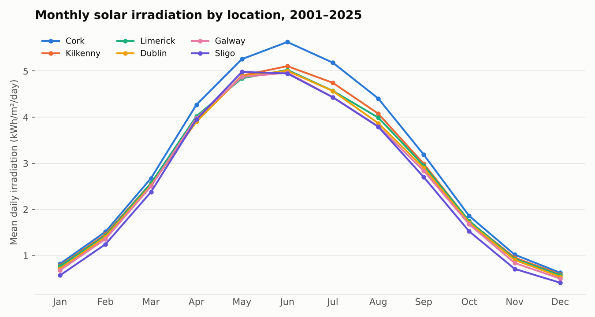
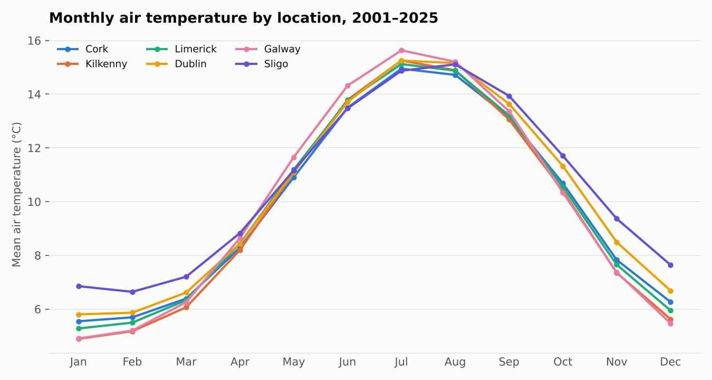
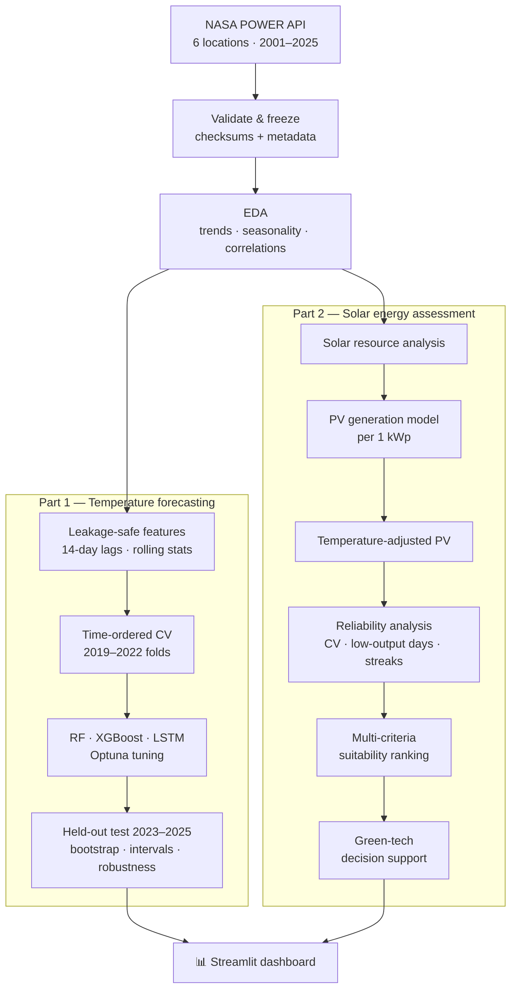

<div align="center">

# 🌤️ Ireland Climate Forecasting & Solar Energy Potential Analysis

### Machine-learning temperature forecasting combined with a solar PV assessment that ranks six Irish locations for green-technology planning, built on 25 years of NASA POWER data


</div>

> [!NOTE]
> This was built as a **client project**, so the source code, processed data and trained models stay private. This repository only describes the approach and what I learned. The underlying dataset is public (see [Dataset](#-dataset)).

---

## 📌 Table of Contents
- [Overview](#-overview)
- [Highlights](#-highlights)
- [Dataset](#-dataset)
- [Pipeline](#-pipeline)
- [Part 1: Temperature Forecasting](#-part-1-temperature-forecasting)
- [Part 2: Solar Energy Potential & Green-Tech Planning](#%EF%B8%8F-part-2-solar-energy-potential--green-tech-planning)
- [Interactive Dashboard](#%EF%B8%8F-interactive-dashboard)
- [Tech Stack](#%EF%B8%8F-tech-stack)
- [Key Learnings](#-key-learnings)
- [Limitations](#%EF%B8%8F-limitations)

---

## 🔭 Overview

Planning for solar panels, heat pumps and energy-efficient buildings depends on two things: **what the weather will do in the next few days**, and **how much usable solar energy a location gets over the long term**. This project answers both for six Irish locations (Dublin, Cork, Galway, Limerick, Sligo and Kilkenny).

**Part 1: Forecasting.** Can machine learning forecast daily air temperature **1, 3 and 6 days ahead**, and does adding solar irradiance history improve the forecasts?

**Part 2: Solar potential.** How much **PV electricity** could each location generate, how **reliable** is that supply across seasons, and which locations are **most suitable** for solar investment?

The results feed an interactive **Streamlit dashboard** for exploring forecasts and solar-planning indicators.

---

## ✨ Highlights

**Forecasting**
- 🤖 Compared **Random Forest, XGBoost and LSTM** across 3 forecast horizons, tuned with **Optuna** on time-ordered validation folds
- 🏆 Every model beat a "tomorrow = today" baseline. The best models cut forecast error by **~8 % at 1 day, ~18 % at 3 days and ~24 % at 6 days**
- 🧪 Used a **paired block bootstrap** to test whether solar features help. The gains were tiny (< 0.4 %) and not statistically significant
- 🎯 Built **90 % prediction intervals** that achieved **87–90 %** coverage on unseen 2023–2025 data

**Solar energy assessment**
- ☀️ Estimated **PV generation per 1 kWp system** for every day over 25 years: **~770–890 kWh/year** depending on location
- 🌡️ Added a **temperature correction** using a standard PV temperature coefficient
- 📉 Measured **reliability**: day-to-day variability, the share of low-output days, and the longest low-output streaks
- 🏅 Built a **weighted multi-criteria suitability ranking**. **Cork ranks #1** and **Sligo #6**, and the order holds under all 4 weighting scenarios tested
- 🧭 Produced **planning guidance**: the best months, the riskiest months and generation estimates for 1–10 kWp systems

---

## 🗂️ Dataset

### Source: NASA POWER (Prediction Of Worldwide Energy Resources)

| Resource | Link |
|---|---|
| 🌐 Official portal | https://power.larc.nasa.gov/ |
| 🗺️ Data Access Viewer (no-code download) | https://power.larc.nasa.gov/data-access-viewer/ |
| ⚙️ Daily API documentation | https://power.larc.nasa.gov/docs/services/api/temporal/daily/ |
| 📚 Data sources & methodology | https://power.larc.nasa.gov/docs/methodology/data/sources/ |

NASA POWER is a free, global, analysis-ready dataset of solar and weather data from NASA Langley Research Center, built for renewable-energy, building and agricultural use.
- **Temperature** comes from NASA's **MERRA-2** reanalysis, on a ½° × ⅝° grid.
- **Solar irradiance** comes from satellite-based **CERES SYN1deg / FLASHFlux**, on a 1° × 1° grid.

### What was downloaded

| Setting | Value |
|---|---|
| API endpoint | `/api/temporal/daily/point` |
| Community | `RE` (Renewable Energy) |
| Time standard | UTC, daily |
| Period | 2001-01-01 → 2025-12-31 |
| Locations | 6 point requests (Dublin, Cork, Galway, Limerick, Sligo, Kilkenny) |
| Rows | **54,786** (6 locations × 9,131 days), with no missing values |

| Parameter | Description | Unit | Used for |
|---|---|---|---|
| `T2M` | Air temperature at 2 m | °C | Forecast target, PV temperature correction |
| `ALLSKY_SFC_SW_DWN` | All-sky surface shortwave downward irradiance | kWh/m²/day | Solar features, PV generation estimates |

The dataset was frozen with a **SHA-256 checksum** and a metadata file recording the API settings and retrieval time, so the results can be reproduced.

**To download the same data:** open the [Data Access Viewer](https://power.larc.nasa.gov/data-access-viewer/), choose *Renewable Energy → Daily → Point*, enter each location's coordinates, set 2001–2025, select `T2M` and `ALLSKY_SFC_SW_DWN`, and export as CSV.

### A look at the public data

<p align="center">
  
  
</p>

Solar irradiation in Ireland swings roughly **10×** between December (~0.5 kWh/m²/day) and June (~5 kWh/m²/day). **Cork receives clearly more sun** than the other five locations from spring through autumn. Temperatures are mild all year (about 5–16 °C), with Sligo the warmest in winter.

---

## 🔬 Pipeline



---

## 🌡️ Part 1: Temperature Forecasting

### Features (all known at forecast time)

| Group | Features | Temperature-only set | + Solar set |
|---|---|:---:|:---:|
| Temperature history | 14-day lags, 3/7/14-day rolling mean & std, 1/7-day change | ✅ | ✅ |
| Calendar | Cyclical day-of-year (sin/cos) | ✅ | ✅ |
| Location | One-hot (6 sites) | ✅ | ✅ |
| Solar history | Same lag, rolling and change features for irradiance | — | ✅ |
| **Total features** | | **30** | **52** |

### Validation design
- **Time-ordered expanding-window folds:** each validation year (2019, 2020, 2021, 2022) is predicted using only data from before it
- **Final held-out test: 2023–2025**, evaluated **once** after all model choices were fixed
- Scalers fit on training data only, with automated checks that no future data leaks into training

### Models

| Model | Input | Tuned with Optuna |
|---|---|---|
| **Random Forest** | Flat feature table | Trees, depth, split/leaf sizes, max features |
| **XGBoost** | Flat feature table | Trees, depth, learning rate, subsampling, regularisation |
| **LSTM** | 14-day sequence + location/calendar context | Units, dropout, learning rate, batch size |

### Results (held-out 2023–2025, rounded)

| Horizon | Best model | RMSE | R² | Better than baseline by |
|:---:|---|---:|---:|---:|
| 1 day | LSTM | ~1.48 °C | ~0.87 | **~8 %** |
| 3 days | LSTM | ~2.06 °C | ~0.75 | **~18 %** |
| 6 days | LSTM | ~2.20 °C | ~0.72 | **~24 %** |

- **Does solar history help temperature forecasts?** Not meaningfully. Adding irradiance features changed RMSE by less than ±1.3 %, and the 95 % bootstrap confidence intervals included zero for most configurations. The temperature–solar link is mostly **shared seasonality**: after removing the seasonal cycle, the correlation is close to zero.
- **Robustness:** Sligo was the easiest location to forecast and Kilkenny the hardest. Summer was the easiest season and winter the hardest.
- **Uncertainty:** 90 % prediction intervals calibrated on validation data only reached 87–90 % actual coverage, at about ±2.4 °C (1 day) to ±3.5 °C (6 days).

---

## ☀️ Part 2: Solar Energy Potential & Green-Tech Planning

### 1 · PV generation model
Daily irradiation was converted into the estimated output of a **reference 1 kWp PV system**:

```
E_PV (kWh/day) = H_d (kWh/m²/day) × P_rated (1 kWp) × PR (0.80)
```

### 2 · Temperature correction
PV panels lose efficiency when hot and gain slightly when cool:

```
T_cell   = T_ambient + 10 °C                  (assumed operating uplift)
F_temp   = 1 + γ × (T_cell − 25 °C),   γ = −0.4 %/°C
E_adjust = E_PV × F_temp
```

Because Irish cells usually run **below 25 °C**, the correction **raises** estimated output by about **+1.3–1.5 %**. A sensitivity test with 0, 10 and 20 °C uplifts showed how much the result depends on this assumption.

### 3 · Annual generation potential (per 1 kWp, rounded)

| Location | Mean annual PV | Summer daily | Winter daily |
|---|---:|---:|---:|
| **Cork** | **~890 kWh** | ~4.1 kWh | ~0.8 kWh |
| Kilkenny | ~826 kWh | | |
| Limerick | ~815 kWh | | |
| Dublin | ~804 kWh | ~3.6 kWh | ~0.7 kWh |
| Galway | ~792 kWh | | |
| Sligo | ~772 kWh | | |

Generation peaks in **May–July** and is lowest in **December** at every location. Summer output is about **5×** winter output.

### 4 · Reliability analysis
"Low-generation days" are days with output below 0.5 kWh per kWp. Thresholds of 0.25 and 0.75 kWh were also tested.

| Location | Low-output days | Longest low-output streak |
|---|---:|---:|
| Cork | **~9 %** | 10 days |
| Kilkenny | ~11 % | 11 days |
| Limerick | ~11 % | 16 days |
| Dublin | ~12 % | 19 days |
| Galway | ~13 % | 25 days |
| Sligo | ~18 % | **47 days** |

Day-to-day variability (coefficient of variation) is high everywhere (**~67–74 %**), which is typical of Ireland's cloudy, changeable climate. It's highest in Sligo.

### 5 · Multi-criteria suitability ranking
Three indicators were min-max normalised and combined with weights:

```
Suitability = 0.50 × Generation score
            + 0.25 × Seasonal-consistency score
            + 0.25 × Low-generation reliability score
```

| Rank | Location | Category |
|:---:|---|---|
| 🥇 1 | **Cork** | Higher relative suitability |
| 🥈 2 | Kilkenny | Higher relative suitability |
| 🥉 3 | Limerick | Moderate |
| 4 | Dublin | Moderate |
| 5 | Galway | Lower |
| 6 | Sligo | Lower |

**Sensitivity check:** the ranking stayed **exactly the same** under four weighting schemes (base, equal weights, generation-focused and reliability-focused), so the result doesn't depend on the chosen weights.

### 6 · Green-technology decision support
- **Best locations for solar:** Cork first, then Kilkenny and Limerick
- **Best months for generation:** May–July. **Highest-risk month:** December at every site
- **System sizing:** estimated annual output for **1, 2, 3, 5 and 10 kWp** systems at each location. For example, a 5 kWp system gives about **4,400 kWh/year in Cork** and about **3,900 kWh/year in Sligo**
- **Planning implication:** winter generation is low and unreliable everywhere, so solar in Ireland works best **paired with storage, the grid or complementary technologies** such as heat pumps or wind

---

## 🖥️ Interactive Dashboard

The Streamlit and Plotly dashboard brings both parts together.

**Forecasting views**
- Forecast explorer: actual vs predicted temperature with 90 % intervals, filtered by location, model, feature set and horizon
- Model performance comparison
- Regional and seasonal reliability
- Solar-feature contribution
- Uncertainty

**Solar energy views** (location and PV-capacity selectors)
- PV generation potential
- Temperature-adjusted assessment
- Solar reliability
- Suitability ranking
- Decision-support summary

---

## 🛠️ Tech Stack

| Area | Tools |
|---|---|
| Language | Python 3.12 |
| Data | pandas, NumPy, SciPy |
| Machine learning | scikit-learn (Random Forest), XGBoost |
| Deep learning | TensorFlow / Keras (LSTM) |
| Tuning | Optuna (TPE sampler) |
| Statistics | Paired block bootstrap, calibrated prediction intervals, multi-criteria normalisation |
| Visualisation & app | Matplotlib, Seaborn, Plotly, Streamlit |
| Reproducibility | Fixed seeds, frozen dataset with SHA-256, environment manifest, artifact checksums |

---

## 💡 Key Learnings

- **Leakage control matters more than model choice.** Time-ordered splits and automated leakage checks made the forecasting results trustworthy. The gap between the best and worst model was small.
- **Always beat a simple baseline.** The baseline comparison showed where ML adds real value: much more at 3–6 days than at 1 day.
- **Correlation isn't the same as predictive value.** Solar and temperature look related, but removing seasonality showed they mostly just share the same yearly cycle.
- **Domain physics adds value on top of ML.** Turning irradiance into kWh with a PV model and temperature correction made the analysis useful for real energy planning.
- **Test your assumptions.** Sensitivity checks on cell temperature, low-output thresholds and ranking weights showed the conclusions were stable, which is what decision-makers need.

---

## ⚠️ Limitations

- PV estimates use a **simplified reference model** (fixed performance ratio, assumed cell-temperature uplift). They don't account for panel tilt, orientation, shading or inverter losses, so they are **planning estimates, not site-specific yield guarantees**.
- NASA POWER values are **gridded satellite and reanalysis estimates**, not on-site measurements, and nearby locations may share grid cells.
- Prediction-interval coverage is **empirical, not guaranteed**.
- **No energy-cost or carbon savings are claimed.** The project evaluates resource potential and forecasting accuracy only.

---

## 🙏 Data Acknowledgement

The data was obtained from the National Aeronautics and Space Administration (NASA) Langley Research Center (LaRC) Prediction of Worldwide Energy Resource (POWER) Project, funded through the NASA Earth Science/Applied Science Program.

---

<div align="center">

**🔒 Source code is private (client project). Happy to walk through the approach in an interview.**

</div>
