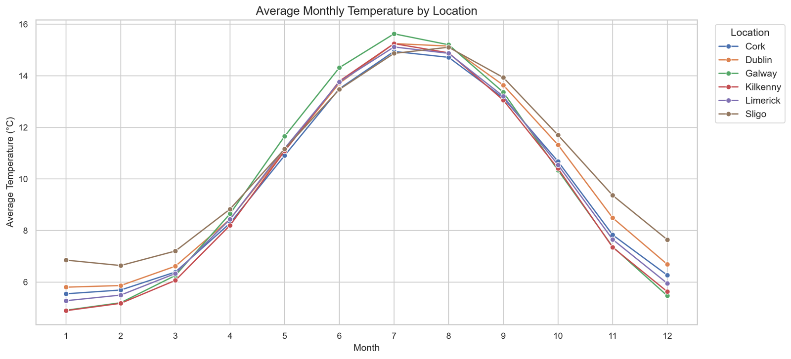
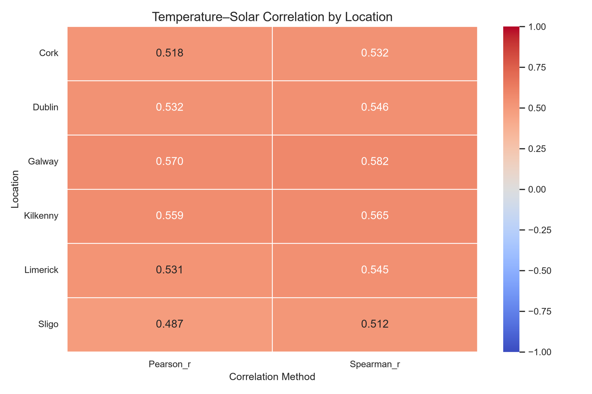

<div align="center">

# 🌤️ Predictive Climate Analytics for Green Technology

### Multi-horizon temperature forecasting across six Irish locations using Random Forest, XGBoost and LSTM, with a test of whether solar irradiance history improves the forecasts


</div>

> [!NOTE]
> This was built as a **client project**. The source code, trained models and processed data are confidential, so this repository only documents the problem, the method and the results. The underlying climate data is public. See [Dataset](#-dataset).

---

## 📌 Table of Contents
- [Overview](#-overview)
- [Key Results](#-key-results)
- [Dataset](#-dataset)
- [Methodology](#-methodology)
- [Models](#-models)
- [Results in Detail](#-results-in-detail)
- [PCIE Dashboard](#-pcie-dashboard)
- [Tech Stack](#-tech-stack)
- [Key Learnings](#-key-learnings)
- [Limitations](#-limitations)
- [Acknowledgements](#-acknowledgements)

---

## 🔭 Overview

Solar PV, heat pumps and building energy systems all depend on short-term temperature forecasts. This project asks two questions:

1. **How accurately can machine learning forecast daily air temperature (T2M) 1, 3 and 6 days ahead** at six Irish locations?
2. **Does adding historical solar irradiance as a feature improve those forecasts**, compared with temperature history alone?

The work follows a nine-phase research pipeline. It runs from data acquisition through leakage-safe feature engineering, chronological validation, Optuna tuning, held-out testing, robustness analysis and uncertainty quantification. The final output is an interactive Streamlit decision-support dashboard, the **Predictive Climatic Intelligence Engine (PCIE)**.

| | |
|---|---|
| **Study area** | Dublin, Cork, Galway, Limerick, Sligo, Kilkenny (Ireland) |
| **Period** | 2001-01-01 → 2025-12-31 (25 years, daily) |
| **Target** | Air temperature at 2 m (T2M, °C) at t + 1, t + 3 and t + 6 days |
| **Models** | Random Forest · XGBoost · LSTM |
| **Experiments** | Feature Set A (temperature only) vs Feature Set B (temperature + solar) |
| **Held-out test** | 2023 – 2025, never seen during tuning or scaling |

---

## 🏆 Key Results

- ✅ **All 18 model configurations beat the persistence baseline** ("tomorrow = today") on the held-out 2023–2025 data.
- 📉 Compared with persistence, the best models cut RMSE by **~7.7 % at 1 day, ~18 % at 3 days and ~24.5 % at 6 days**.
- 🧠 **LSTM was the most accurate model** at every horizon, with a 1-day RMSE of **1.48 °C** (R² = 0.873).
- ☀️ **Solar irradiance added little.** It gave a small RMSE gain (≤ 0.4 %) at 1 day, and every 95 % bootstrap confidence interval for those gains included zero. At 3 and 6 days it slightly *hurt* accuracy.
- 🎯 The **90 % prediction intervals** achieved **87–90 % empirical coverage** on unseen data.
- 🗺️ **Sligo was the easiest location to forecast and Kilkenny the hardest. Winter was the hardest season and summer the easiest.**

---

## 🗂️ Dataset

### Source: NASA POWER (Prediction Of Worldwide Energy Resources)

| Resource | Link |
|---|---|
| 🌐 Official portal | https://power.larc.nasa.gov/ |
| 🗺️ Data Access Viewer (no-code download) | https://power.larc.nasa.gov/data-access-viewer/ |
| ⚙️ Daily API documentation | https://power.larc.nasa.gov/docs/services/api/temporal/daily/ |
| 📚 Data sources & methodology | https://power.larc.nasa.gov/docs/methodology/data/sources/ |

NASA POWER is a free, global, analysis-ready dataset of solar and meteorological parameters run by NASA Langley Research Center and designed for renewable-energy, building and agricultural applications.
- **Meteorological parameters** such as T2M come from NASA GMAO's **MERRA-2** reanalysis, extended to near real time with **GEOS-IT**, on a ½° × ⅝° grid.
- **Solar parameters** come from satellite-based **CERES SYN1deg** and **CERES FLASHFlux**, on a 1° × 1° grid.

### What was downloaded

| Setting | Value |
|---|---|
| API endpoint | `/api/temporal/daily/point` |
| Community | `RE` (Renewable Energy) |
| Time standard | UTC |
| Resolution | Daily |
| Period | 2001-01-01 → 2025-12-31 |
| Locations | 6 point requests |

### Variables

| Parameter | Description | Unit | Role |
|---|---|---|---|
| `T2M` | Air temperature at 2 metres | °C | Forecast target + predictor |
| `ALLSKY_SFC_SW_DWN` | All-sky surface shortwave downward irradiance | kWh/m²/day | Experimental predictor (Set B) |

### Locations

| Location | Latitude | Longitude |
|---|---:|---:|
| Dublin | 53.333 | −6.249 |
| Cork | 51.898 | −8.471 |
| Galway | 53.272 | −9.051 |
| Limerick | 52.665 | −8.623 |
| Sligo | 54.270 | −8.469 |
| Kilkenny | 52.654 | −7.252 |

### Dataset profile

| Property | Value |
|---|---|
| Rows | **54,786** (6 locations × 9,131 days) |
| Columns | `Date, Location, Latitude, Longitude, T2M, ALLSKY_SFC_SW_DWN` |
| Missing values | 0 |
| Duplicate location-dates | 0 |
| T2M range | −5.69 °C to 24.86 °C (mean 10.0 °C, SD 4.2 °C) |
| Solar range | 0.07 to 8.73 kWh/m²/day (mean 2.79) |

To keep results reproducible, the combined dataset was **frozen after validation** with a SHA-256 checksum and a metadata file recording the API settings, coordinates and retrieval timestamp. The pipeline also checked that no two locations returned identical time series. The data itself was not modified.

**Steps to download the same data:** open the [Data Access Viewer](https://power.larc.nasa.gov/data-access-viewer/), choose *Renewable Energy* → *Daily* → *Point*, enter each coordinate above, set the date range 2001–2025, select `T2M` and `ALLSKY_SFC_SW_DWN`, and export as CSV.

<p align="center">
  
  
</p>

---

## 🔬 Methodology


### Phase overview

| Phase | Stage | What was done |
|:---:|---|---|
| 1 | **Data acquisition** | Pulled daily data for 6 locations from the NASA POWER API, validated it and froze it with checksums |
| 2 | **EDA** | Ran descriptive statistics, annual and monthly trends, and seasonal distributions. Computed Pearson/Spearman correlations, **deseasonalised** correlations and lagged correlations |
| 3 | **Feature engineering** | Built 14-day lag windows, rolling mean/std, day-to-day changes, cyclical day-of-year encoding and one-hot locations. Created targets for 1, 3 and 6 days ahead |
| 4 | **Chronological validation** | Set up expanding-window folds (validation years 2019–2022) and a final held-out test (2023–2025), with an automated **leakage audit** on every boundary |
| 5 | **Model optimisation** | Ran Optuna TPE (20 trials per model × feature set), minimising mean fold RMSE |
| 6 | **Final training & testing** | Refit with frozen hyperparameters and evaluated once on 2023–2025. Ran a paired block bootstrap and calibrated prediction intervals |
| 7 | **Robustness analysis** | Broke down performance by location, season and horizon, and analysed large errors |
| 8 | **PCIE dashboard** | Built a Streamlit and Plotly app to explore the held-out forecasts |
| 9 | **Verification** | Added the persistence benchmark, logged the environment and checksums, and audited the research objectives |

### Feature engineering (leakage-safe)

All predictors use only information available at **forecast origin *t***. Future T2M values appear only as target labels, and an automated audit confirmed **zero target overlap** with predictors.

| Group | Features | Set A | Set B |
|---|---|:---:|:---:|
| Temperature lags | `T2M_lag_0 … T2M_lag_13` (14-day lookback) | ✅ | ✅ |
| Temperature rolling stats | mean & std over 3 / 7 / 14 days | ✅ | ✅ |
| Temperature change | 1-day and 7-day deltas | ✅ | ✅ |
| Calendar | `Day_sin`, `Day_cos` (cyclical day-of-year) | ✅ | ✅ |
| Location | one-hot encoding of 6 sites | ✅ | ✅ |
| Solar lags | `Solar_lag_0 … Solar_lag_13` | — | ✅ |
| Solar rolling stats & changes | mean/std over 3/7/14 days, 1/7-day deltas | — | ✅ |
| **Total** | | **30** | **52** |

### Validation design

The data was split by time, never at random, so no future information could reach training:

- **Tuning:** four expanding folds, each training on all data before its validation year (2019, 2020, 2021, 2022).
- **Final test:** models were refit on targets up to 2022 and evaluated **once** on 2023–2025.
- Scalers were fit **only on training data**, and model selection was fixed **before** the test set was opened.

---

## 🤖 Models

| Model | Input format | Tuned search space (Optuna TPE) | Selected (Set B) |
|---|---|---|---|
| **Random Forest** | Flat tabular features | `n_estimators` 100–300, `max_depth` 5–25, `min_samples_split/leaf`, `max_features` | 150 trees, depth 11, `max_features=0.7` |
| **XGBoost** | Flat tabular features | `n_estimators` 100–400, `max_depth` 3–9, `learning_rate` 0.01–0.2, `subsample`, `colsample_bytree`, `reg_lambda` | 400 trees, depth 4, lr ≈ 0.035 |
| **LSTM** | 14-step sequence (temp ± solar channels) + context vector | `units` {32, 64, 96}, `dropout` 0–0.3, `learning_rate` 3e-4–3e-3, `batch_size` | 96 units, dropout 0.3, lr ≈ 5e-4, batch 64 |

**LSTM architecture:**

```
Input (14 timesteps × channels)
  → LSTM(units)
  → Dropout(rate)
  → Dense(32, ReLU)
  → Dense(1)            # predicted T2M
Loss: MSE · Optimiser: Adam · EarlyStopping (patience 5, restore best weights)
```

Each sequence channel (temperature and solar) has its own `StandardScaler`, fit only on training windows.

**Benchmark:** a **persistence** forecast, which predicts that T2M at t + h equals T2M at t.

---

## 📊 Results in Detail

### Held-out test performance, 1-day horizon (2023–2025)

| Model | Feature Set | RMSE (°C) | MAE (°C) | R² |
|---|:---:|---:|---:|---:|
| **LSTM** | **B** | **1.477** | 1.133 | **0.873** |
| LSTM | A | 1.479 | 1.135 | 0.872 |
| XGBoost | B | 1.479 | **1.123** | 0.872 |
| XGBoost | A | 1.484 | 1.129 | 0.871 |
| Random Forest | B | 1.507 | 1.146 | 0.867 |
| Random Forest | A | 1.512 | 1.153 | 0.867 |
| *Persistence* | — | *1.600* | *1.191* | *0.850* |

### Performance across forecast horizons (best model per horizon)

| Horizon | Best model | RMSE (°C) | R² | Persistence RMSE | Improvement |
|:---:|---|---:|---:|---:|---:|
| 1 day | LSTM (B) | 1.477 | 0.873 | 1.600 | **+7.7 %** |
| 3 days | LSTM (A) | 2.056 | 0.754 | 2.513 | **+18.2 %** |
| 6 days | LSTM (A) | 2.201 | 0.719 | 2.917 | **+24.5 %** |

As the horizon grows, persistence degrades much faster than the ML models, so learned models add the most value further ahead.

### Does solar irradiance help? (Set B vs Set A)

RMSE improvement from adding solar features, with **95 % CIs from a paired block bootstrap** (1,000 reps, 14-day blocks):

| Model | 1 day | 3 days | 6 days |
|---|---|---|---|
| LSTM | +0.10 % [−0.62, 0.69] | −0.18 % [−1.07, 0.70] | −0.47 % [−1.75, 0.92] |
| XGBoost | +0.37 % [−0.09, 0.87] | −0.20 % [−0.96, 0.51] | −0.58 % [−1.29, 0.13] |
| Random Forest | +0.32 % [−0.21, 0.91] | −0.72 % [−1.40, −0.03] | −1.24 % [−2.06, −0.40] |

**Interpretation:** solar history adds almost nothing beyond what 14 days of temperature history already contains. EDA points the same way. The raw temperature–solar correlation is moderate (r ≈ 0.49–0.57) but mostly reflects shared seasonality, and after **deseasonalising** it falls to roughly zero or slightly negative (r ≈ −0.04 to −0.14).

### Regional and seasonal robustness

| Dimension | Easiest | Hardest | Notes (LSTM, 1-day) |
|---|---|---|---|
| **Location** | Sligo (RMSE ≈ 1.06 °C) | Kilkenny (≈ 1.64 °C) | Inland sites vary more day to day |
| **Season** | Summer (≈ 1.11 °C) | Winter (≈ 1.79 °C) | Winter weather is more volatile |

### Uncertainty quantification

**90 % prediction intervals** were calibrated from **validation-fold residuals only**, using a conservative finite-sample quantile. Test data was never used.

| Horizon | Interval width (±) | Empirical coverage on 2023–2025 |
|:---:|---:|---:|
| 1 day | ≈ ±2.4 °C | 89.2 – 89.5 % |
| 3 days | ≈ ±3.3 °C | 87.7 – 90.0 % |
| 6 days | ≈ ±3.5 °C | 87.1 – 89.2 % |

---

## 🖥️ PCIE Dashboard

The **Predictive Climatic Intelligence Engine** is a Streamlit and Plotly app for exploring the validated held-out forecasts. It has five tabs:

| Tab | Purpose |
|---|---|
| 🔎 **Forecast Explorer** | Actual vs predicted T2M with 90 % intervals for any location, model, feature set and horizon |
| 📈 **Model Performance** | RMSE / MAE / R² comparison across all 18 configurations |
| 🗺️ **Regional & Seasonal** | Breakdown of reliability by location and season |
| ☀️ **Solar Contribution** | Where solar features help or hurt, by region and season |
| 🎯 **Uncertainty & Decision Support** | Interval coverage and green-technology planning insights |

> The dashboard shows **historical held-out forecasts**. It is a research and decision-support explorer, not a live forecasting service.

---

## 🛠️ Tech Stack

| Area | Tools |
|---|---|
| Language | Python 3.12 |
| Data | pandas, NumPy, SciPy |
| Machine learning | scikit-learn (Random Forest), XGBoost |
| Deep learning | TensorFlow / Keras (LSTM) |
| Tuning | Optuna (TPE sampler, SQLite-backed studies) |
| Visualisation | Matplotlib, Seaborn, Plotly |
| App | Streamlit |
| Reproducibility | Fixed seeds, frozen dataset with SHA-256, environment manifest, artifact checksums |

---

## 💡 Key Learnings

- **Leakage control matters more than model choice.** Chronological splits, scaler fitting only on training data and an automated leakage audit made the results trustworthy. The gap between the best and worst model was only about 0.03 °C at 1 day.
- **Always beat a naïve baseline.** The persistence benchmark showed where ML actually adds value: much more at 3–6 days than at 1 day.
- **Correlation ≠ predictive value.** Solar and temperature look correlated, but deseasonalising showed that the link is mostly shared seasonality. The bootstrap CIs confirmed the gain wasn't significant.
- **Report uncertainty, not just point accuracy.** Calibrated intervals with measured coverage are more useful for energy planning than a single RMSE number.
- **Lock decisions before testing.** Fixing hyperparameters and model selection before opening the test set kept the evaluation honest.

---

## ⚠️ Limitations

- The solar contribution is **predictive, not causal**.
- NASA POWER values are **gridded reanalysis and satellite estimates**, not station measurements, and nearby locations may share grid influence.
- Prediction-interval coverage is **empirical, not guaranteed**.
- **No energy, cost or carbon savings are claimed.** The project evaluates forecasting accuracy only.

---

## 🙏 Acknowledgements

The data was obtained from the National Aeronautics and Space Administration (NASA) Langley Research Center (LaRC) Prediction of Worldwide Energy Resource (POWER) Project, funded through the NASA Earth Science/Applied Science Program.

---

<div align="center">

**🔒 Source code is private.

⭐ If you found this useful, consider starring the repo!

</div>
